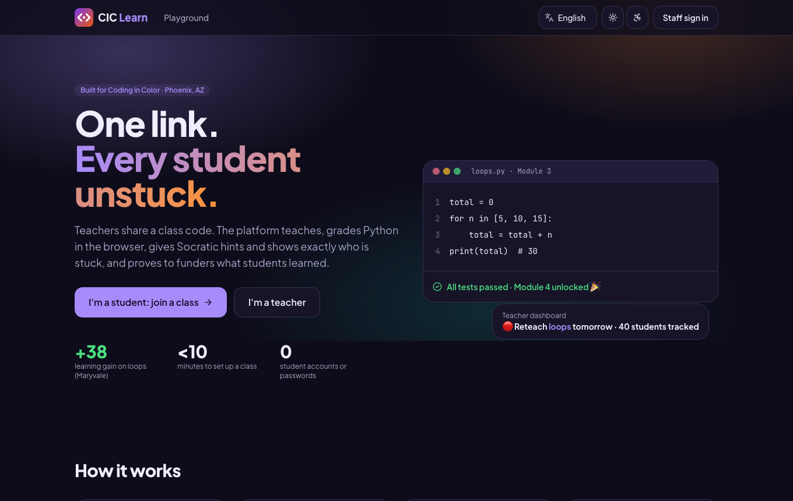
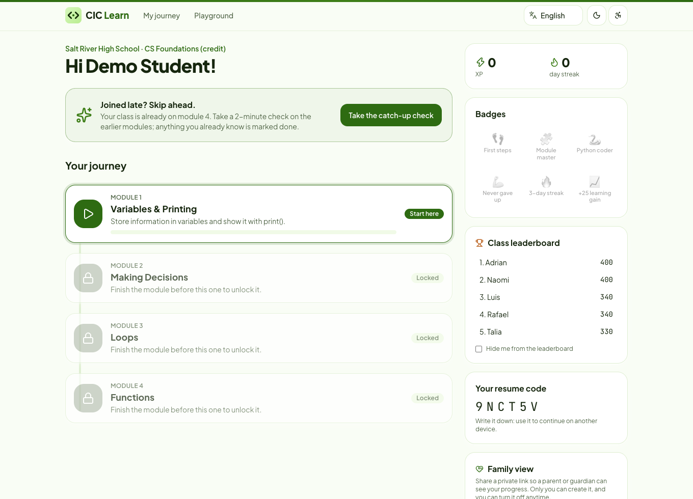
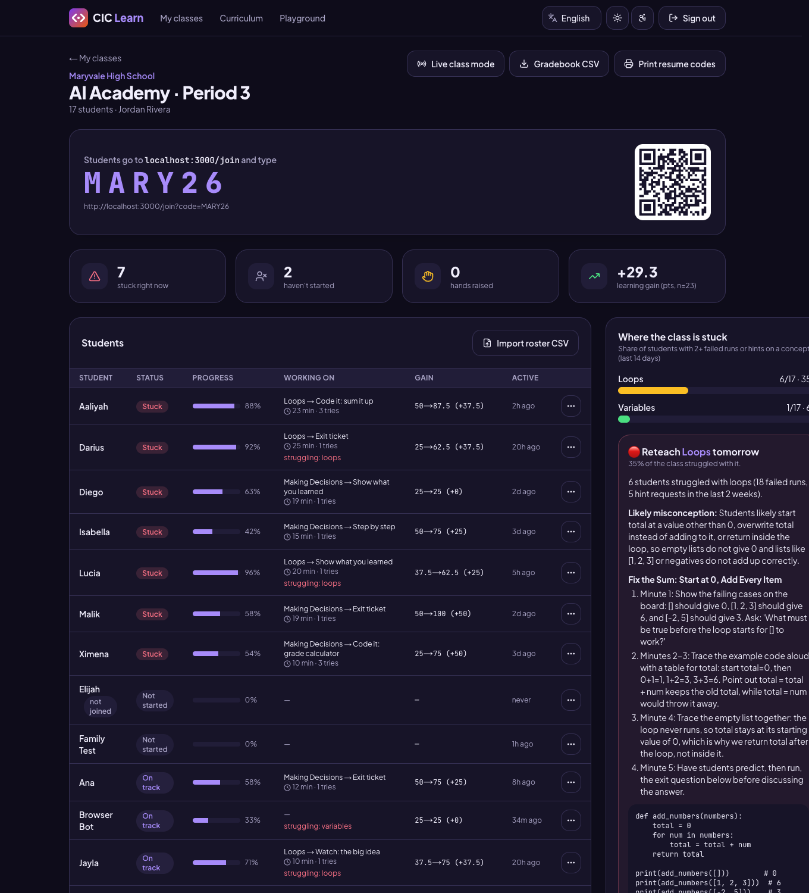
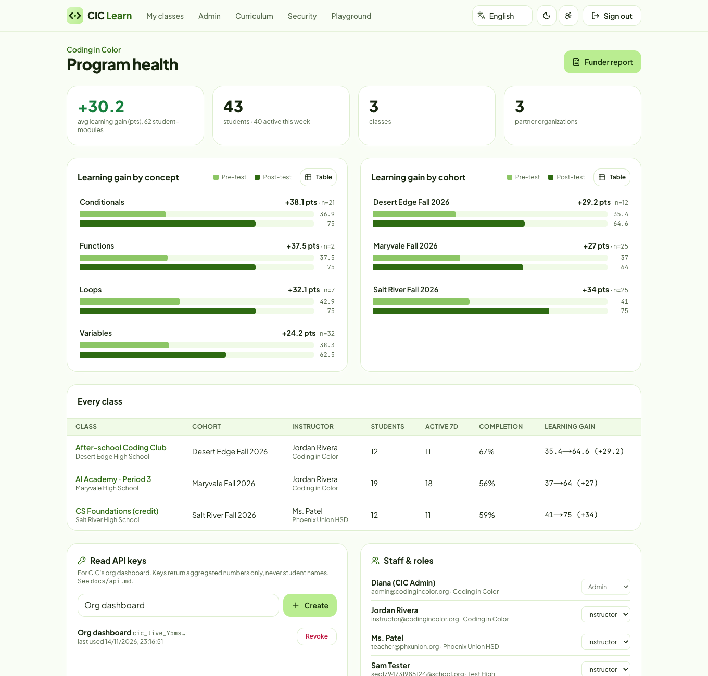
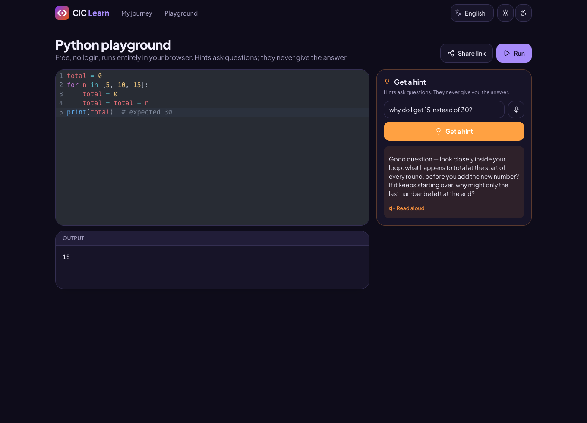
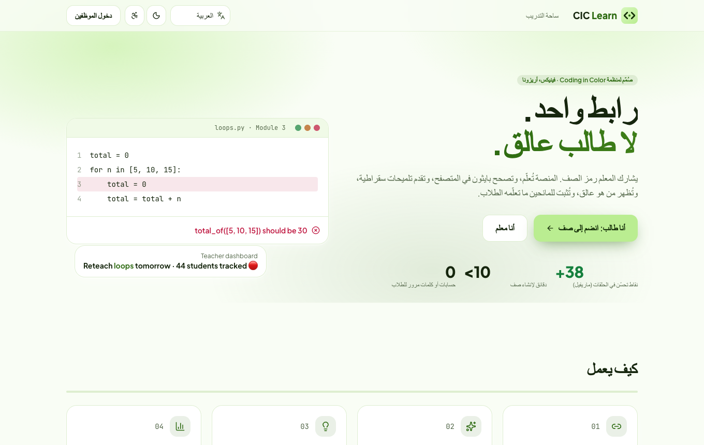

# CIC Learn · SuperHacks for Coding in Color

**One link. Every student unstuck.** · 🔗 **Live: https://cic-learn-pink.vercel.app** A code.org-style curriculum and student-progress platform for
[Coding in Color](https://codingincolor.net): a teacher shares a class code, the platform teaches CIC's
curriculum, grades real Python in the browser, gives Socratic hints that never hand over the answer,
shows exactly who is stuck on what, and proves to funders how much students learned.

Built at [ASU Fall Hackathon 2026 | Phoenix Hackathon for Nonprofits: Nov 14-15](https://www.ohack.dev/hack/fall-2026) for the public good (MIT license).

| | |
|---|---|
| **Nonprofit** | [Coding in Color](https://www.ohack.dev/nonprofit/YIXYdYCoxIZC08uQ5DL3) |
| **Problem statement** | [Curriculum & Student Progress Platform (CIC Problem 1)](https://www.ohack.dev/project/d09466fadf1b11f18e63deadc507a848) |
| **Team page** | [SuperHacks](https://www.ohack.dev/hack/fall-2026/team/c43737f0e06211f1a967deadb145c312) · [Team Dashboard](https://www.ohack.dev/hack/fall-2026/manageteam) (story, demo video, submit) |
| **Slack** | team: [#superhacks](https://opportunity-hack.slack.com/app_redirect?channel=superhacks) · nonprofit: [#npo-coding-in-color](https://opportunity-hack.slack.com/app_redirect?channel=npo-coding-in-color) · help: [#ask-a-mentor](https://opportunity-hack.slack.com/archives/C01E5CGDQ74) |
| **Created by** | Pumpking |

> **⚠️ This is your team's ONE repository — all code goes here.** Please don't create
> another repo (personal or org). Judges, the Team Dashboard's code-activity card,
> the public project page and the nonprofit all read **this** repo; work pushed
> anywhere else is invisible to them and won't count.

**Docs for each reader:** [Teacher guide](docs/teacher-guide.md) · [Curriculum author guide](docs/author-guide.md) ·
[Read API](docs/api.md) ([OpenAPI](docs/openapi.yaml)) · [Architecture](docs/architecture.md) · [Security & privacy](docs/security.md) ·
[Accessibility](docs/accessibility.md) · [Deploying](docs/deploy.md) · [Monday handoff plan](HANDOFF.md)

---

## What we built

CIC's classes ran on slide decks and printed worksheets: partner teachers needed training to deliver them, nobody
knew which module a student was on, a student who missed a week fell behind for good, and learning gain lived in
spreadsheets. CIC Learn replaces that with a link a teacher can share on Monday.

| Brief success criterion | How CIC Learn meets it |
|---|---|
| A teacher with no CS background runs a module by sharing a link | Students join with a **class code + first name** (no accounts). The platform teaches each module: video → check for understanding → digital worksheet → auto-graded Python → exit question. |
| A student works self-paced and the next module unlocks | Activities and modules unlock in order, **enforced on the server**. |
| A student who joins late catches up | A **2-minute catch-up check** places late joiners: modules they already know are marked "tested out". |
| Set up a class, import a roster CSV and assign a module in < 10 min | One-screen wizard: name → paste/upload roster (Google Classroom / SIS exports) → tick modules. **About 2 minutes.** |
| Learning gain per student and per class without a spreadsheet | Every module has a pretest and an identical posttest (counted once, answers never revealed). Gain per student, class, cohort and concept. |
| An outside K12 teacher or district admin can review the curriculum | Teachers can self-register; **reviewers** get a read-only teacher edition with answer keys. |
| CIC's org dashboard pulls completion and learning gain via a read API | `GET /api/v1/stats` with a Bearer key: aggregated numbers only, never student names. |
| CIC staff publish modules without engineering | **Curriculum editor** with a form for every activity type, drafts, publish, reorder, remix. |

### Beyond the brief

- **Stuck map + "reteach tomorrow".** Every failed run and hint becomes a struggle signal tagged with a concept. Teachers see "6/15 struggled with loops" and get a one-click 5-minute warm-up built from their class's actual mistakes.
- **Socratic AI hints that never give the answer**, enforced three ways: prompt rules, a check that rejects any hint containing a line of the solution, and a rule-based fallback. Students can ask by voice and have hints read aloud. Every hint is visible to the teacher.
- **Worksheet → module (AI).** Paste a worksheet or upload a photo of one; AI drafts the whole module (slides, quiz, worksheet, auto-graded exercise, pre/post tests) for an instructor to review and publish. AI translation creates a draft copy in another language without touching code or answer keys.
- **CIC Helper chatbot**: a small button on every page that answers *how do I…?* questions in the visitor's language, using only the platform's own guides. It refuses to do students' exercises (it points them to the Socratic hint button) and stores no conversations.
- **Offline mode**: *Save for offline* downloads a student's lessons and the Python runtime; work submitted without internet waits in an on-device outbox and syncs automatically (the server still grades and enforces unlock order).
- **No-login Python playground** (`/play`) with share links for camps on locked-down lab machines.
- **Verifiable certificates and funder reports.** Only a SHA-256 fingerprint is recorded on Solana. Names and scores never go on-chain. Anyone can check `/verify/<id>`.
- **Funder report**: a printable one-pager with learning gain by concept and class.
- **Live class mode, raise hand, pair programming, XP/streaks/badges** (leaderboard opt-out), **consent-gated family view**, **gradebook CSV**, **offline mode** for slow school Wi-Fi.
- **8 languages**: English, Español, العربية (right-to-left), Français, Português, हिन्दी, 中文, Tiếng Việt. AI hints, voice input and read-aloud follow the student's language. Plus a reading-mode menu: dyslexia-friendly font, high contrast, reduced motion, lite mode, dark mode.

## Screenshots

| | |
|---|---|
|  |  |
| **Landing**: live learning-gain numbers | **Student journey**: modules unlock in order; late joiners can skip ahead |
|  |  |
| **Teacher dashboard**: who's stuck, where, and an AI reteach plan | **Admin**: learning gain by concept and cohort, API keys, roles |
|  |  |
| **Socratic hint**: a question, never the answer | **Arabic**: full right-to-left layout |

## Try it (demo data is seeded automatically)

| Who | How |
|---|---|
| Student | Open `/join`, type **`MARY26`** (or `EDGE26`, `SALT26`), tap a name or add yourself |
| CIC admin | `admin@codingincolor.org` |
| CIC instructor | `instructor@codingincolor.org` (owns Maryvale and Desert Edge) |
| Partner-school teacher | `teacher@phxunion.org` (owns Salt River) |
| District reviewer (read-only) | `reviewer@district.org` |

Staff demo password: **`cic-demo-2026`** (set `DEMO_PASSWORD` to change it, or `SEED_DEMO_DATA=false` for a clean install).

## Tech stack

- **Frontend:** Next.js 15 (App Router, React 19), Tailwind CSS, Framer Motion, CodeMirror 6
- **Backend:** Next.js server actions and route handlers (TypeScript), zod validation on every input
- **Database:** PostgreSQL (Supabase or any Postgres in production; [PGlite](https://pglite.dev) embedded Postgres locally, so no setup)
- **Python:** [Pyodide](https://pyodide.org) (CPython in WebAssembly) in a Web Worker, so student code never runs on our server
- **APIs / services:** any OpenAI-compatible API for AI (ChatGPT, the OHack gateway, Qwen…), Solana devnet (Memo program) for proofs, Vercel for hosting

## Run it locally

Requires **Node.js 20.18+** (22 recommended).

```bash
git clone https://github.com/2026-Arizona-Opportunity-Hack/SuperHacks-CodinginColor.git
cd SuperHacks-CodinginColor
cp .env.example .env   # every variable is optional for local dev; never commit .env
npm install
npm run dev            # http://localhost:3000, database is created and seeded in .data/
```

```bash
npm test               # 14 unit + integration tests on an in-memory Postgres
npm run typecheck
npm run build && npm start   # production build
npm run db:reset       # wipe the local database (re-seeded on next start)
```

### Environment variables

| Variable | Needed for | Default / notes |
|---|---|---|
| `DATABASE_URL` | Production database | Empty → embedded PGlite in `.data/`. Use your Supabase **transaction pooler** URI in production. |
| `OPENAI_API_KEY` | AI hints, worksheet converter, translation, reteach plans | Empty → rule-based hints and built-in plans; AI-only tools are disabled. |
| `OPENAI_BASE_URL` | Non-OpenAI providers | e.g. `https://ai.ohack.dev/v1`. Empty → OpenAI. |
| `AI_MODEL` | Model name | `gpt-4o-mini`; on the OHack gateway use `muse-wonder` |
| `AI_MIN_TOKENS` | Room for reasoning models to think | `4000` |
| `AI_DISABLE_THINKING` | Qwen-style hosts | `true` to skip slow "thinking" mode |
| `SOLANA_SECRET_KEY` | Anchoring certificates/reports on-chain | Empty → proofs are hashed but not anchored. Devnet key is fine. |
| `SOLANA_RPC_URL` | Solana cluster | `https://api.devnet.solana.com` |
| `AUTH_SECRET` | Encrypting 2FA secrets at rest | **Required in production**: a long random string (`openssl rand -base64 32`) |
| `REQUIRE_ADMIN_2FA` | Force admins to use two-step verification | `false`; set `true` for a real install |
| `SEED_DEMO_DATA` | Demo data on an empty database | `true`; set `false` for a real install |
| `DEMO_PASSWORD` | Password of seeded staff accounts | `cic-demo-2026` |
| `SHOW_DEMO_ACCOUNTS` | Demo-account hint on the sign-in page | `true`; set `false` in production |

Deploying to Vercel + Supabase takes about 10 minutes: see [docs/deploy.md](docs/deploy.md).

## Project layout

```
db/schema.sql                 one SQL file: the whole data model (runs on Postgres and PGlite)
src/app/                      pages and API routes (Next.js App Router)
  join/ learn/                student flow: join, journey map, module player, catch-up check
  teach/                      instructor: classes, new-class wizard, dashboard, codes, gradebook
  admin/                      program health, API keys, roles, audit log, funder report
  curriculum/                 library, editor, AI converter (read-only for reviewers)
  play/ family/ verify/       playground, family view, certificate/report verification
  api/                        activity submit, hints, pair programming, read API (v1/stats)
src/lib/                      server logic: db, auth, grading, progress, stats, tutor, proofs
src/components/               UI: activity views, code editor, charts, header, accessibility menu
src/i18n/                     UI dictionaries for 8 languages (add one: copy es.ts, translate, register in config.ts)
public/pyodide-worker.js      runs student Python in the browser
public/sw.js                  offline support
tests/                        node:test suites (npm test)
```

## Team

- Onkar (https://github.com/onkarf1) — AI Fullstack Engineer
- Puneet Kumar (https://github.com/Pun33t-B0kk4) — Backend
- Karthik — Frontend (inactive)

## Links

- Live demo: **https://cic-learn-pink.vercel.app** (class code `MARY26`; staff logins below)
- Demo video:
- Design / docs: [docs/](docs)

## Final day

Start recording your demo video by **Sun Nov 15, 12:00 PM MST** — hacking ends at **Sun Nov 15, 2:00 PM MST**.

- Sun Nov 15, 11:00 AM MST — Presentation Feedback Hour
- **Sun Nov 15, 12:00 PM MST — Start recording your demo video**
- Sun Nov 15, 12:30 PM MST — Judges Arrive
- **Sun Nov 15, 2:00 PM MST — 🛑 Submission Deadline: Hacking ends**
- Sun Nov 15, 2:05 PM MST — Judging Round 1
- Sun Nov 15, 3:40 PM MST — Judging Final Round
- Sun Nov 15, 4:30 PM MST — Closing Ceremony: Winners Announced

### Submission checklist

- [ ] **Code pushed** to this repo, in small PRs (see `AGENTS.md`)
- [ ] **Project story** written on the dashboard (`#project`)
- [ ] **Demo video** (4 minutes or less) linked on the dashboard (`#demo`)
- [ ] **Submit** on the dashboard
- [x] This README filled in: team, tech stack, how to run it

Judges score **Scope, Documentation, Polish and Security**, plus a separate **Accessibility** prize: [ohack.dev/hackathon-judging-criteria](https://www.ohack.dev/hackathon-judging-criteria).

## Credits

- **Team badges**: [Team Lanyard Rail](https://21st.dev/@dhxwhy/components/team-lanyard-rail) by @dhxwhy (21st.dev), adapted to our theme tokens.
- **Walking crowd**: adapted from *Skiper 39 · Canvas Crowd* by [Skiper UI](https://skiper-ui.com) (@gurvinder-singh02); free licence with attribution. Illustrations: [Open Peeps](https://www.openpeeps.com) by Pablo Stanley (CC0). Sprites showing a knife are excluded.
- **World map**: [Natural Earth](https://www.naturalearthdata.com) via [world-atlas](https://github.com/topojson/world-atlas), rendered with [d3-geo](https://github.com/d3/d3-geo).
- **Python in the browser**: [Pyodide](https://pyodide.org). **Animation**: [GSAP](https://gsap.com), [Framer Motion](https://www.framer.com/motion/).

## After the hackathon

Winning teams finish the project with the nonprofit: the [Definition of Done](https://www.ohack.dev/about/completion) (deployed, nonprofit sign-off, docs, open source) is tracked on the team page. Our plan for that is in [HANDOFF.md](HANDOFF.md).
