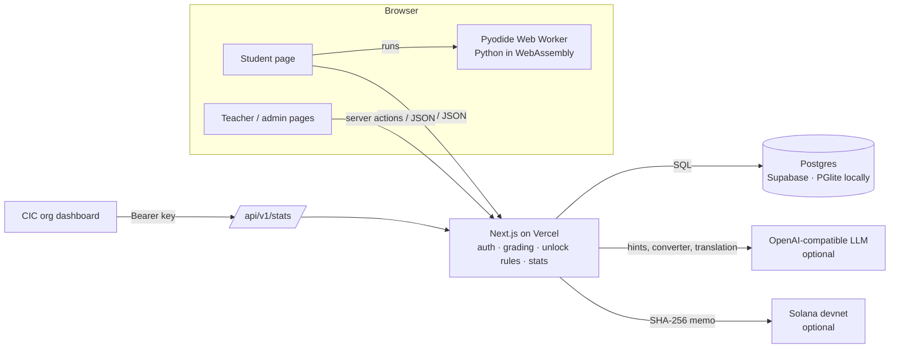

# Architecture

CIC Learn is one Next.js app on one Postgres database. A 2–10 person nonprofit has to run it after the
weekend, so we chose the fewest moving parts that meet the brief.



## Decisions

| Decision | Why | Trade-off |
|---|---|---|
| **Next.js full-stack, one repo, one deploy** | Volunteers rotate every semester; one codebase is easiest to hand over. Free on Vercel. | Server logic lives in server actions rather than a separate API (except the read API). |
| **Plain SQL in one file** (`db/schema.sql`), no ORM | Anyone who knows SQL can read the whole model in 5 minutes; the same file runs on Supabase and PGlite. | Queries are hand-written (all parameterised). |
| **PGlite locally** | `npm run dev` works with zero setup: no Docker, no database install. | PGlite is single-process; production uses real Postgres via `DATABASE_URL`. |
| **Python runs in the browser (Pyodide)** | No student accounts, no server sandbox to secure or pay for, works offline. | ~10 MB first download (cached afterwards). Code-test results are reported by the client (low-stakes practice; quizzes are graded server-side). |
| **Students have no accounts** | They're minors on shared lab machines; CIC chose CodeHS at camp to avoid accounts. A device cookie + 6-character resume code is enough. | A student could tap a classmate's unclaimed name; teachers see this and can release a seat. |
| **Learning gain = posttest − pretest on identical questions** | Simple, explainable to funders, comparable across classes. | Pre/post count once and never reveal answers, so the measurement stays honest. |
| **Struggle signals as events** (`struggle_events`) | Failed runs and hints tagged by concept are cheap to store and power the stuck map, reteach plans and AI-hint review. | Heuristic "stuck" thresholds (15 min, 3 attempts, 2+ signals) are tunable in `src/lib/stats.ts`. |
| **AI is optional and model-agnostic** | Any OpenAI-compatible API (ChatGPT, OHack gateway, Qwen). Every AI feature has a deterministic fallback, so a missing key or outage never breaks class. | Fallback hints are generic. |
| **Blockchain only for fingerprints** | A ledger is public and permanent; student data must never go there. Hashes give tamper-evidence for certificates and funder reports. | Requires a funded Solana wallet; off by default. |

## Data model (short)

```
users ─┬─ sessions                    staff: admin / instructor / reviewer
       └─ classes ── class_modules ── modules ── lessons ── activities (kind + JSON content)
              └─ students ─┬─ progress (per activity: status, score, answer, attempts, time)
                           ├─ placements (tested out of a module)
                           ├─ struggle_events (fail / hint / pass, by concept)
                           ├─ hand_raises · family_links · proofs
api_keys · audit_log · pair_rooms
```

## Request flow: a student checks their code

1. `CodeView` sends the code and tests to the Pyodide worker. If it runs longer than 8 s the worker is killed (infinite loops).
2. The result is posted to `POST /api/activity/:id/submit`. The server checks the student's cookie, that the module is unlocked for them and that earlier steps are done, then stores progress and a `fail`/`pass` struggle event.
3. If the student asks for a hint, `POST /api/hint` builds a prompt with the exercise, their code, the failing test and the (secret) solution; the reply is rejected if it contains a solution line, and logged for the teacher.
4. The teacher's dashboard aggregates those events into the stuck map (`src/lib/stats.ts`).

## Where to change things

| To change… | Edit |
|---|---|
| Unlock rules | `src/lib/progress.ts` |
| "Stuck" thresholds, learning-gain math | `src/lib/stats.ts` |
| Hint rules / fallback hints | `src/lib/tutor.ts` |
| Activity content shapes and validation | `src/lib/content.ts` |
| Starter curriculum | `src/lib/curriculum-seed.ts` (or just use the editor) |
| UI text / translations | `src/i18n/*.ts` |
| Brand colours | CSS variables at the top of `src/app/globals.css` |
